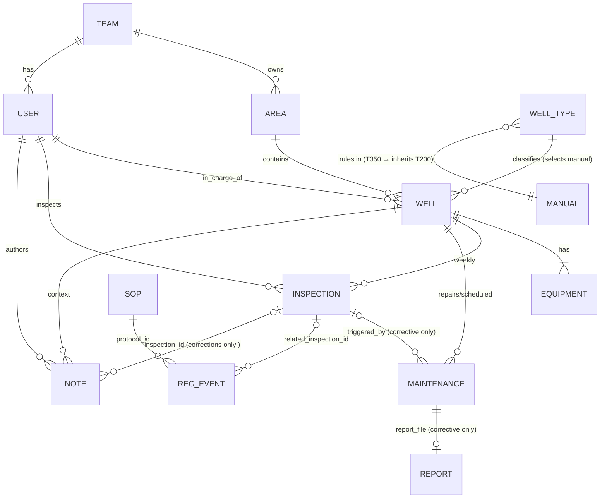

# Data Map, Traps & Answer-Key Audit

Measured on the **sample** dataset (2026-10-17). The test dataset has "the same format, more wells,
more history", so **treat every number here as sample-specific**. The system must re-profile any dataset
it loads (`make profile`) instead of assuming these values.

---

## 1. Structure at a glance



```
fleet/
  areas.json            4 areas × 50 wells · center lat/lon · team_id ; 5 teams (lead_user_id)
  users.json            15 users · role ∈ {production_supervisor, field_operator, field_inspector,
                        maintenance_lead, maintenance_technician, hse_officer} · team_id
  well-types/T200.md    OM-T200 rev 4: §9.3 producing ⇔ Δ ≥ 15 °C · §9.4 alarm > 85 °C · §9.5 spill > 5 % pad ⇒ shut-in
                        §10 RCA ≥ 3 corrective / same equipment / 12 mo · downtime > 14 consecutive days ⇒ report
                        §4 planned shut-in must be recorded in the maintenance system before work
  well-types/T350.md    OM-T350 rev 2: Δ ≥ 20 °C · alarm > 95 °C · "procedures not listed follow T200"
  sops/spill-response   classes minor <1 · moderate 1–<5 · reportable 5–<25 · major ≥25 bbl
                        SR-01 written notice 24 h (2 h major) · SR-02 contain ≤ 4 h · SR-03 ≤1 % TPH, ≥4 samples,
                        agency verification ≤ 60 d (reportable+) · SR-04 record every spill · §7 corrected ≠ spill
  sops/regulatory       RC-01 inspect ≤ 14 d · RC-02 flowline test / calendar yr · RC-03 > 14 d down ⇒ supervisor
                        RC-04 NOV answered ≤ 30 d · RC-05 flowline maintenance program
  sops/field-work       WS-01..07 (safety meeting, LOTO, H2S 10 ppm, hot work 10 % LEL, 1.25×MOP 4 h test,
                        waste manifest, report ≤ 3 d)
assets/WELL-XXXX/  (200 wells)
  metadata.json         asset_id, name, well_type{T200:119,T350:81}, area_id, team_id, in_charge_user_id,
                        location{lat,lon}, installed_on, equipment[{equipment_id,kind,model}],
                        last_inspection{inspection_id,inspected_at,inspector_user_id}, recorded_status{active,down}
  inspections.jsonl     39,567 rows · inspection_id INS-<well>-<n> · inspected_at (UTC) · inspector_user_id ·
                        method{drone,manual} · ambient_temp_c · wellhead_temp_c · spill_detected ·
                        spill_area_pct / spill_est_volume_bbl (null unless detected; 672 detections) ·
                        evidence_images[] (files not supplied) · notes (1,501 non-empty)
  maintenance.jsonl     5,665 rows · MNT-<well>-<n> date-ordered · started_at/completed_at (completed may be
                        > today = in progress) · maintenance_type{scheduled,corrective} · equipment_kind · issue ·
                        action_taken · technician_user_id · contractor? · downtime_hours (per job, NOT well
                        downtime) · cost_usd{labor,parts,total} · triggered_by_inspection_id? · report_file?
  maintenance-reports/  1,509 markdown reports (exactly one per corrective job); filenames vary → follow report_file
  regulatory-events.jsonl 90 rows · spill_report_filed 36 · site_inspection 34 · notice_of_violation 11 ·
                        nov_response_filed 9 · protocol_id · related_inspection_id · hours_to_report? · fine_usd · status
  context.jsonl         141 notes · correction 56 (all carry inspection_id) · operator_note 82 · operator_feedback 3 ·
                        valid_from / valid_to (59 open-ended)
```

### Derived concepts (never stored; must be computed from rules)
| Concept | Definition | Rule source |
|---|---|---|
| producing (per reading) | `wellhead − ambient ≥ θ(type)` | manual §9.3 / T350 §3 |
| downtime | 7 days × non-producing inspections in the period (missed = 0) | Dataset Guide |
| real spill | detected ∧ no correction note for that inspection | SOP-SR §7 |
| spill class | volume bands (corrected volume wins) | SOP-SR §3 |
| breach / pending | deadline from trigger vs satisfying evidence | SR-0x, RC-0x, manual §4/§10 |
| "right now" | each well's latest inspection | Example Scenarios |
| explanation | notes whose `valid_from..valid_to` covers the reading + open repairs | Dataset Guide + Q1/Q2 |

---

## 2. Traps (planted and natural)

| # | Trap | Evidence in sample | Correct handling |
|---|---|---|---|
| E1 | **Hot idle wellheads** | 36 readings ≥ 45 °C that are *not* producing (e.g. INS-0001-0140: 51.6 °C vs 43.1 °C air) | only Δ matters; never absolute temperature |
| E2 | **Stale `recorded_status`** | 21 wells disagree with their latest reading, both directions (WELL-0001 "active" at Δ 3.2; WELL-0002 "down" at Δ 30.5) | inspections are the truth; say "recorded status is out of date" |
| E3 | **Corrected detections** | 56 correction notes: shadow (23), produced water (17), wet soil/rain (16) | exclude from spill counts and statistics; keep visible as corrected |
| E4 | **Disagreement ≠ correction** | CTX-0101-002 / -003 are `operator_feedback`, **no `inspection_id` field** (the ID is only in the text) | parse the ID from text for linking; never treat as a correction; show both |
| E5 | **Facts only in free text** | containment hours appear only in reports: 211 > 4 h (SR-02 "**Not met**"), 405 ≤ 4 h, 893 non-spill reports | extract with spans; cite the report |
| E6 | **Non-standard report filenames** | `MNT-0001-july-2025-prime-mover.md`, `MNT-0001-june-2026-flowline-spill.md` | always follow `report_file` |
| E7 | **Hand-written outlier reports** | the June-2026 WELL-0001 report uses prose ("contained about 7 hours after the inspection flight", "filed 41 hours after detection", SR-03 "In progress") | regex first, LLM fallback with spans |
| E8 | **Per-job `downtime_hours` ≠ well downtime** | every record has it; the Dataset Guide forbids using it | downtime only from inspections |
| E9 | **In-progress repairs** | 8 jobs with `completed_at` > today (e.g. MNT-0170-031, MNT-0172-028) | "still open" / ongoing |
| E10 | **Missed inspections / gaps** | ~2 % missed; 14 gaps of 21 days (RC-01 breaches) | missed = 0 downtime; RC-01 check by gap |
| E11 | **Notes with validity windows** | 81 templated operator notes (pipeline tie-in, weather delay, parts wait) + CTX-0001-003 (7–20 Oct) | explanation only when the window covers the reading |
| E12 | **Notes that sound like rule changes** | CTX-0001-002 "expect ~3 °C lower wellhead temperature; this is normal" | context only; **does not** change the manual threshold |
| E13 | **Planned work not in the maintenance system** | CTX-0001-003 "work order not yet in the maintenance system" | manual §4 open action (Q9) |
| E14 | **`hours_to_report` vs event date** | it measures the *written notice*; NOV dates are weeks later (e.g. REG-0001-002) | never derive reporting time from the NOV date |
| E15 | **Inspection notes that imply status** | "Pump jack not moving." 217 · "No stroke observed" 209 · "Unit stopped, brake set." 204 · "Wellhead cold to touch." 198 | conflict evidence when a correction or claim disagrees (Q12/Q15) |
| E16 | **Spill notes** | "Pooled fluid near flowline", "Dark staining on pad", "Oil sheen around cellar" … | context for spills; not a volume source |
| E17 | **`inspector_user_id` is not always an inspector** | 13,075 inspections by field operators (e.g. Jake Morales) | report by name; don't infer role from the field name |
| E18 | **Negative Δ** | 216 readings with wellhead < ambient (sensor noise) | valid not-producing readings; don't drop them |
| E19 | **Spill > 5 % of pad ⇒ immediate shut-in** | 386 detections > 5 % pad | relevant for "was it handled correctly?" questions |
| E20 | **Long repairs** | e.g. MNT-0053-021 runs Mar → May | windowing by `started_at` (repairs) |
| E21 | **Reportable spills** | 36 detections ≥ 5 bbl, all with a filed report in the sample; Q13 *creates* one via correction | reportability recomputed after every correction |
| E22 | **Rule inheritance** | T350 manual defers RCA/procedures to T200 | `INHERITS` resolution; cite both sections |
| E23 | **Wells drilled mid-period** | history starts later for some wells | per-well window clipping; no "missing" downtime |
| E24 | **No borderline readings in the sample** | 0 readings within 0.5 °C of a threshold | the test set may differ: implement ≥ exactly, show Δ and θ |

What we **checked and found clean** in the sample: no schema variants (except optional `inspection_id`
on notes) · no duplicate or out-of-order IDs · cost labor + parts = total everywhere · report totals, hours,
trigger IDs and volumes match the records · no corrections on non-spill inspections. **None of this is
guaranteed for the test set.** The profiler re-checks all of it at ingest and reports drift.

---

## 3. Answer-key audit (expected answers are hypotheses)

The organisers may include deliberately wrong expectations, and the final questions are new. We
treat the key as a *claim to verify*, not ground truth.

| Q | Expected | Independent recomputation | Status |
|---|---|---|---|
| Q2 | 4 wells NE-8 | WELL-0164/0170/0172/0175 | ✅ agrees |
| Q3 | 13 readings 23 Jul–15 Oct; not producing 8 & 15 Oct | same | ✅ |
| Q4 | 6 spills, 15.1 bbl | same | ✅ |
| Q5 | 21 days | same (24 Jul, 16 Oct, 23 Oct) | ✅ |
| Q6 | 49 / 42 / 42, next 28 | same (window conventions indistinguishable) | ✅ |
| Q7 | 4 pins | same | ✅ |
| Q8 | 35 / 43 / 37 / 26 | same totals (monthly cells not yet checked) | ✅ partial |
| Q9 | 3 flowline correctives; RC-02 met 7 Mar 2026 | MNT-0001-028/029/032; MNT-0001-026 on 2026-03-07 | ✅ partial |
| Q10 | WELL-0082 7.1 h, WELL-0100 8.1 h | same | ✅ |
| Q11 | 25,794 / 46,942 / 5,176 | same (2026 repairs by start date) | ✅ |
| Q14 | 3 wells → 4 with T350 rule | same; a fleet-wide rule would wrongly add WELL-0102 | ✅ |
| Q1, Q12, Q13, Q15–Q18 | memory and conflict behaviour | to be verified by scenario tests | ⏳ |

**Policy:** the eval runner reports `disagrees_with_key` as its own category. A human triages each one as
(a) our bug, (b) a key error, or (c) ambiguity (e.g. window convention). We never patch prompts to
match a key we believe is wrong. Instead, the answer states its assumptions (window, as-of, overlays).
